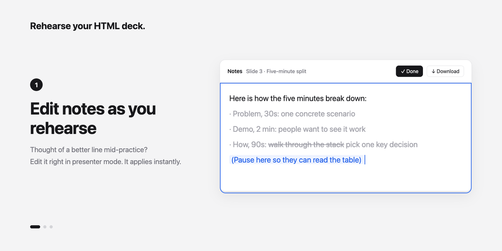
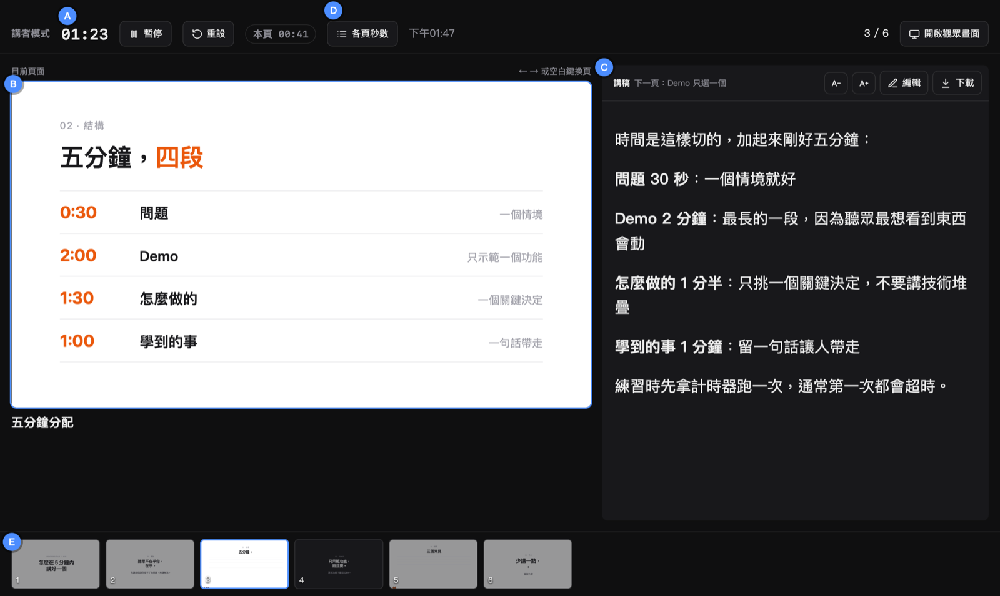
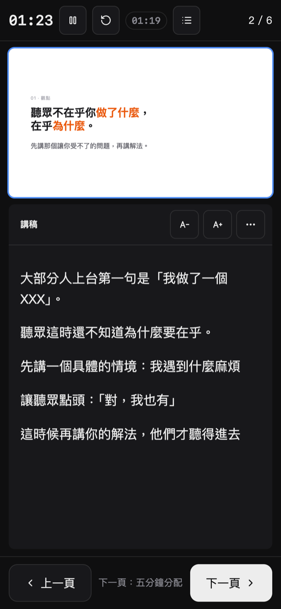
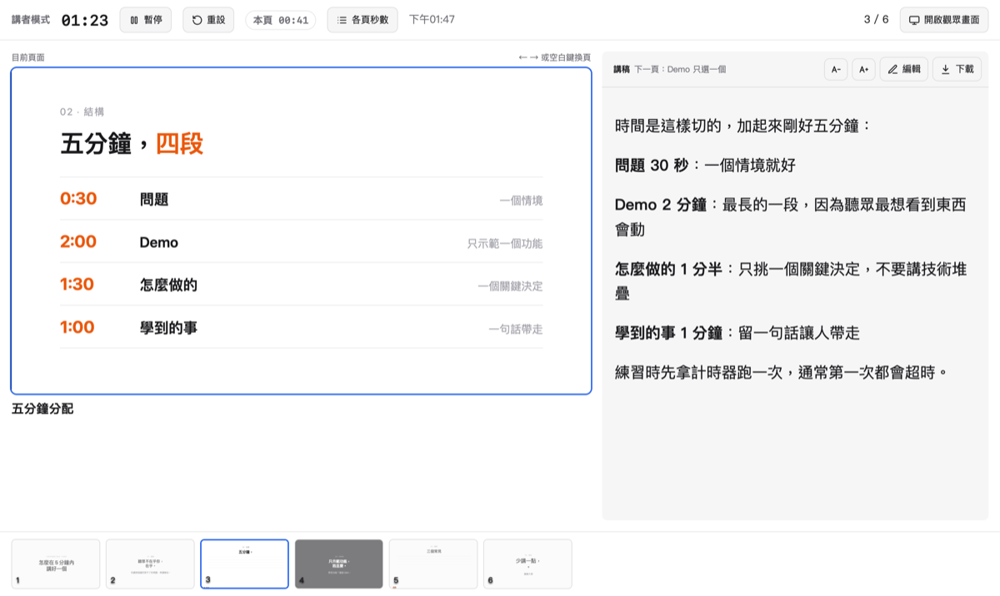
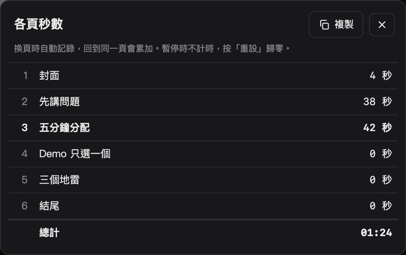
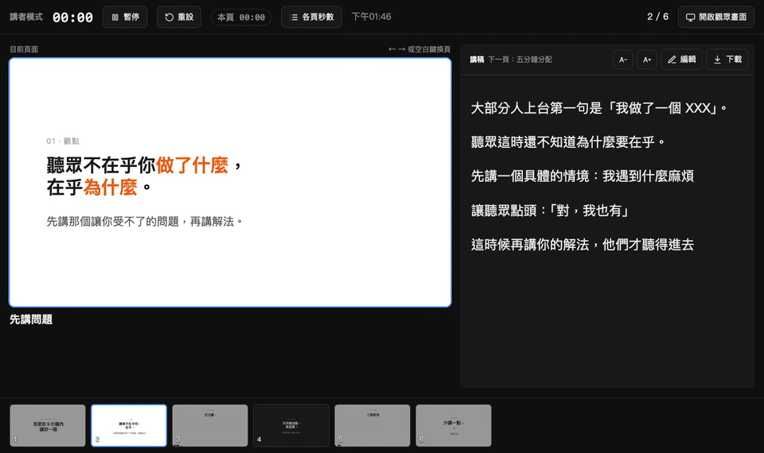
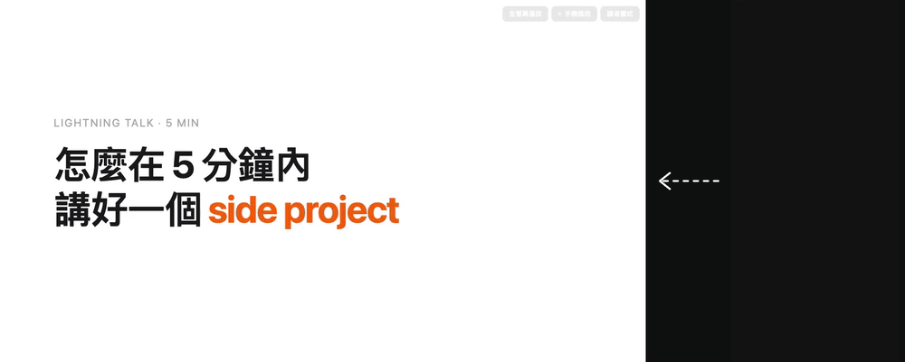

# Rehearse

[繁體中文](README.md) · **English**

More and more people build slides in HTML, and often let an AI agent write them. But once the slides are done, there's still no good tool for rehearsing: somewhere to keep your speaker notes, fix them as you practice, and see how long each slide takes.

**Rehearse is that rehearsal tool.** Slides and speaker notes live in `deck.js`. Let your agent (Claude Code, Codex, Cursor…) write them, and you focus on rehearsing.

**Why HTML**: it works everywhere. Drop in images, GIFs and videos, animate with CSS, and extend it however you like.

It's a plain static site: nothing to install, no build step. Host it anywhere.

> The interface is currently in Traditional Chinese.



## Presenter mode



- **(A)** Total time and time on this slide. Click to pause
- **(B)** Current slide, synced with the audience view
- **(C)** Speaker notes. Edit them in place and change the font size
- **(D)** Seconds spent on each slide
- **(E)** Thumbnail strip. Click to jump to a slide

**Extended display**: in presenter mode, click the open-audience-view button to open a second, synced window. Drag it to the projector or extended display and press `F` for fullscreen. Your laptop keeps the notes and timers. Only the slides go to the projector, so you never have to worry about your notes showing up on screen.

<table>
<tr>
<td width="24%" valign="top"></td>
<td width="44%" valign="top"></td>
<td width="32%" valign="top"></td>
</tr>
<tr>
<td valign="top"><b>Phone</b>: notes come first, with big next/previous buttons and swipe to change slides</td>
<td valign="top"><b>Light mode</b>: follows your system setting</td>
<td valign="top"><b>Seconds per slide</b>: after a run-through, you know which slide runs long</td>
</tr>
</table>

## The rehearsal loop



1. While you practice, click "Edit" to change the notes. Edits are saved in this browser
2. Click "Download" to get the notes as Markdown
3. Hand it to your agent: "Write these notes back to deck.js"

## More features

**Phone remote** (optional): scan a QR code and change slides from your phone. No shared Wi-Fi needed. See [Phone remote setup](#phone-remote-setup).



<sub>Left: the audience view. Right: presenter mode on a phone. The two are actually connected through Supabase; this isn't an edit.</sub>

- **Video slides**: videos are fully preloaded when the deck opens, so they play even if the venue's network drops. You can play and pause them from presenter mode
- The audience view and presenter mode stay in sync on the same computer, with no setup

## Getting started

```bash
git clone https://github.com/111588004/rehearse my-talk
```

```bash
cd my-talk && python3 -m http.server
```

Open http://localhost:8000, then tell your agent:

> Following the format in AGENTS.md, turn this outline into a deck: …

The format is documented in [AGENTS.md](AGENTS.md) (in Traditional Chinese), and it's readable for humans too.

## Deploying

The folder is the website. Deploy it as-is to Vercel, Netlify, GitHub Pages or Cloudflare Pages.

Note: **once deployed, `deck.js` is public, and so are your speaker notes.** If you want to keep them private, only run it locally.

## Phone remote setup

If you open the audience view and presenter mode in two windows on the same computer, they sync automatically with no setup.

To change slides from your phone, you need a free [Supabase](https://supabase.com) project as a relay. It only uses Realtime broadcast, so no tables are created.

1. Create a Supabase project
2. In Project Settings → API, copy the Project URL and the anon (publishable) key
3. Put them in `config.js`

```js
window.DECK_CONFIG = {
  supabase: { url: 'https://xxxx.supabase.co', key: 'eyJ...' },
};
```

A phone remote button then appears in the top-right corner of the audience view. The anon key is meant to be used in browsers and is safe to publish. **Never put your service_role key here.**

## Keyboard shortcuts

| Key | Action |
|---|---|
| → ↓ Space Enter PageDown | Next slide |
| ← ↑ Backspace PageUp | Previous slide |
| Home / End | First / last slide |
| F | Fullscreen |
| P | Presenter mode |
| K / M | Play/pause or mute the video |

## Files

| File | Purpose |
|---|---|
| `deck.js` | Slides and speaker notes. **This is the only file you need to edit** |
| `assets/` | Images and videos |
| `config.js` | Phone remote settings (optional) |
| `index.html` | Audience view |
| `presenter.html` | Presenter mode |
| `remote.js` | Phone remote connection |
| `qrcode.js` | [qrcode-generator](https://github.com/kazuhikoarase/qrcode-generator) (MIT) |

## License

MIT
