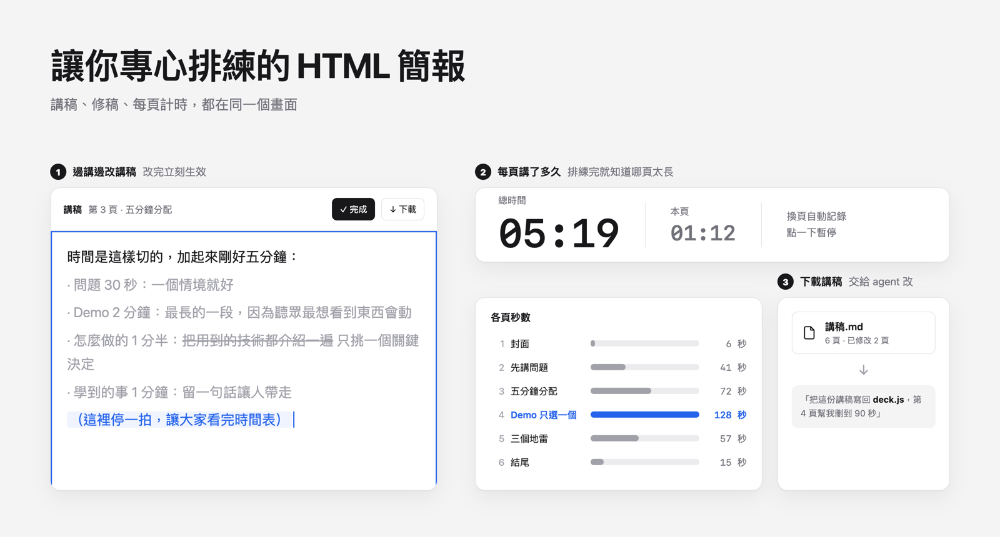
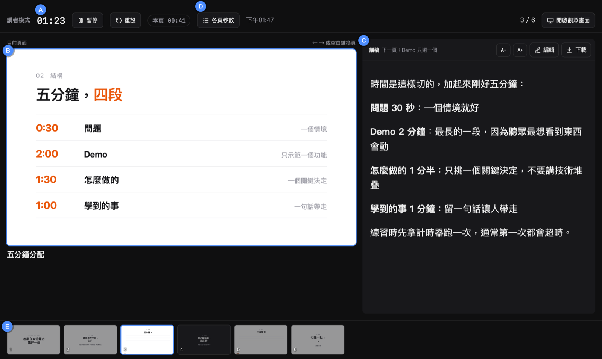
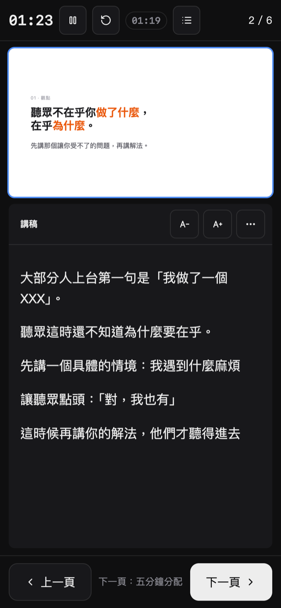
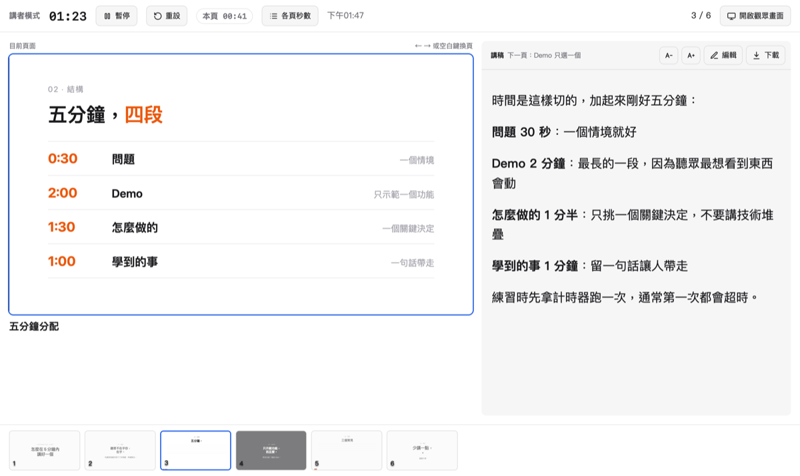
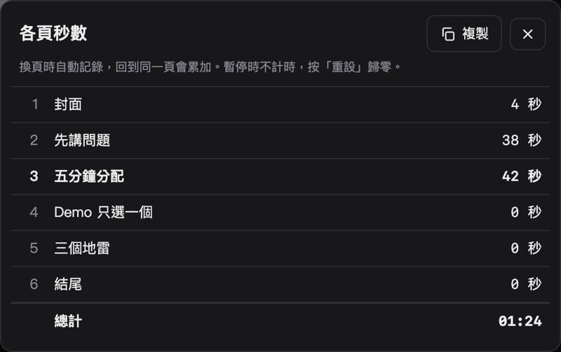
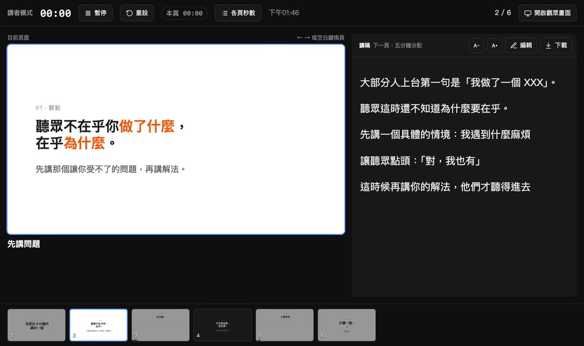
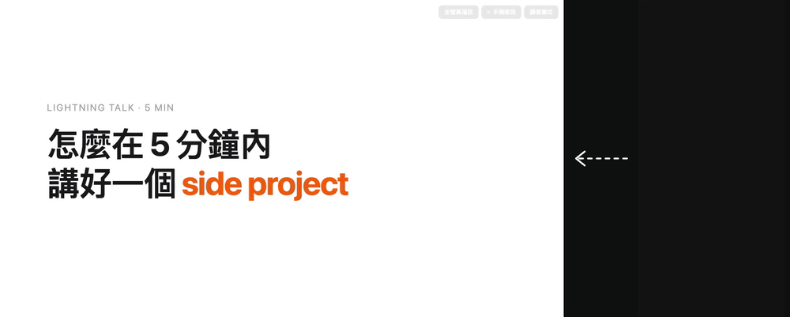

# Rehearse 排練

越來越多人用 HTML 做簡報，也常交給 AI agent 來寫。但投影片做完之後，還缺一個好用的排練工具：放講稿、邊練邊修講稿、記錄每頁講了多久。

**Rehearse 就是這個排練工具。** 投影片和講稿都寫在 `deck.js`，交給你的 agent（Claude Code、Codex、Cursor……）來做，你專心排練。

**為什麼用 HTML**：相容性高，圖片、GIF、影片都能直接放，也能用 CSS 做動畫，想加什麼都很容易擴充。

純靜態網頁，不用安裝、沒有 build，丟到任何靜態主機就能用。



## 講者模式



- **(A)** 總計時和本頁計時，點一下暫停
- **(B)** 目前頁面，跟觀眾畫面同步
- **(C)** 講稿，可以直接編輯、調整字級
- **(D)** 各頁秒數統計
- **(E)** 縮圖列，點一下跳頁

<table>
<tr>
<td width="24%" valign="top"></td>
<td width="44%" valign="top"></td>
<td width="32%" valign="top"></td>
</tr>
<tr>
<td valign="top"><b>手機版</b>：講稿是主角，底部有大顆換頁鍵，可以左右滑</td>
<td valign="top"><b>淺色模式</b>：跟著系統自動切換</td>
<td valign="top"><b>各頁秒數</b>：排練完就知道哪一頁講太久</td>
</tr>
</table>

## 排練循環



1. 邊講邊按「編輯」改講稿，改過的存在這台電腦
2. 按「下載」拿到一份 Markdown
3. 交給 agent：「把這份講稿寫回 deck.js」

## 其他功能

- **[手機遙控](#手機遙控)**（選用）：手機掃 QR code 翻頁，不用連同一個 Wi-Fi
- **影片頁**：開簡報時整支預載，會場斷網也能播；講者模式可以控制播放
- 同一台電腦的觀眾畫面和講者模式自動同步，不用設定

## 開始

```bash
git clone https://github.com/111588004/rehearse my-talk
```

```bash
cd my-talk && python3 -m http.server
```

打開 http://localhost:8000 。接著跟你的 agent 說：

> 照 AGENTS.md 的格式，幫我把這份大綱做成簡報：……

格式說明在 [AGENTS.md](AGENTS.md)，人看也看得懂。

## 部署

整個資料夾就是網站，Vercel、Netlify、GitHub Pages、Cloudflare Pages 都可以直接部署。

注意：**部署後 `deck.js` 是公開的，講稿也一樣。** 不想公開講稿，就只在本機跑。

## 手機遙控



<sub>左邊是觀眾畫面，右邊是手機上的講者模式；兩邊透過 Supabase 真的連線，不是剪接。</sub>

同一台電腦開「觀眾畫面」和「講者模式」兩個視窗，不用設定就會自動同步。

想用手機翻頁，需要一個免費的 [Supabase](https://supabase.com) 專案當中繼（只用到 Realtime broadcast，不建資料表）：

1. 建立 Supabase 專案
2. 到 Project Settings → API，複製 Project URL 和 anon（publishable）key
3. 填進 `config.js`

```js
window.DECK_CONFIG = {
  supabase: { url: 'https://xxxx.supabase.co', key: 'eyJ...' },
};
```

觀眾畫面右上角就會出現「手機遙控」。anon key 本來就是給瀏覽器用的公開金鑰；**不要放 service_role key**。

## 快捷鍵

| 按鍵 | 動作 |
|---|---|
| → ↓ 空白 Enter PageDown | 下一頁 |
| ← ↑ Backspace PageUp | 上一頁 |
| Home / End | 第一頁／最後一頁 |
| F | 全螢幕 |
| P | 講者模式 |
| K / M | 影片播放暫停／靜音 |

## 檔案

| 檔案 | 用途 |
|---|---|
| `deck.js` | 簡報內容和講稿，**你只需要改這個** |
| `assets/` | 圖片、影片 |
| `config.js` | 手機遙控設定（選用） |
| `index.html` | 觀眾畫面 |
| `presenter.html` | 講者模式 |
| `remote.js` | 手機遙控連線 |
| `qrcode.js` | [qrcode-generator](https://github.com/kazuhikoarase/qrcode-generator)（MIT） |

## 授權

MIT
